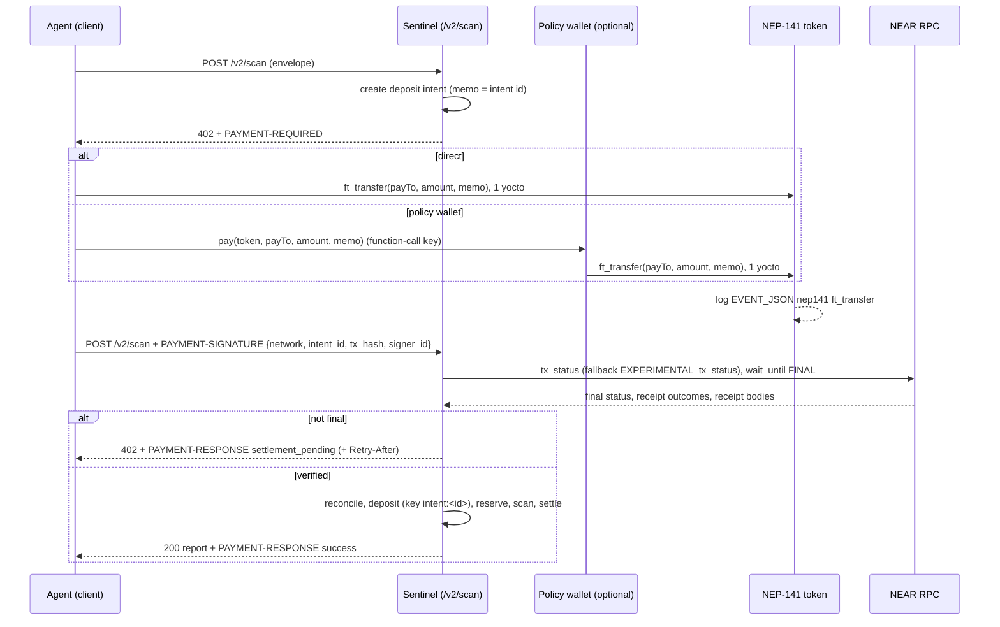

# x402 on NEAR: the near-tx-proof profile

Status: **proposed profile, not upstream.** Implemented in
`crates/api/src/x402.rs` (transport and facilitator) and
`crates/near-adapter/src/verify.rs` (receipt-level verifier). Profile
version 1 (2026-11-06).

## What is new here, and what is not

x402 already has a NEAR binding upstream: the `exact` scheme on
`near:mainnet` / `near:testnet` (`scheme_exact_near.md`, package
`@x402/near`), in which the payer signs a NEP-366 `SignedDelegateAction`
for one `ft_transfer` and a facilitator relayer submits it. This project
does **not** claim to be the first x402 on NEAR.

The contribution is two things the upstream binding does not cover:

1. **A client-submitted payment-proof method** (`near-tx-proof`) for the
   `exact` scheme, in which the payer is free to submit its own
   transaction, including through a **spend-policy wallet contract**
   driven by a function-call key. The upstream method requires a
   FullAccess key and rejects function-call keys, because a function-call
   key cannot attach the 1 yoctoNEAR an `ft_transfer` needs. A policy
   wallet's `pay` method takes no deposit, so an agent holding only a
   function-call key can pay through it.
2. **Receipt-level verification**: the proof is accepted only when the
   token contract's own NEP-141 transfer event, inside the finalized
   receipt tree, pays the gateway with the server-issued memo. Wallet
   payments (cross-contract receipts) verify exactly like direct
   transfers, and events logged by any other contract are ignored.

## Pinned sources

| Source | Pin | Accessed |
|---|---|---|
| Core spec `specs/x402-specification-v2.md`, x402-foundation/x402 | commit `e187dda1ef` | 2026-10-21 |
| HTTP transport `specs/transports-v2/http.md` | commit `e187dda1ef` | 2026-11-04 |
| `exact` scheme families (facilitator-submitted, client-submitted) `specs/schemes/exact/scheme_exact.md` | commit `8228bd6d83` (the family text arrived in `23173acb53`, 2026-09-02, after `e187dda1ef`) | 2026-11-04 |
| NEAR binding `specs/schemes/exact/scheme_exact_near.md` | commit `f5dd40efb4` | 2026-10-21 |
| NEP-141 events, NEP-297 format | https://github.com/near/NEPs (neps/nep-0141.md, nep-0297.md) | 2026-10-21 |
| Transaction status RPC | https://docs.near.org/api/rpc/transactions | 2026-10-21 |
| CAIP-2 `near` namespace (not yet registered; PR #203 open) | https://github.com/ChainAgnostic/namespaces/pull/203 | 2026-10-21 |

Repository: https://github.com/x402-foundation/x402. Detailed research
notes: `docs/research/x402-v2-and-near-profile.md`,
`docs/research/nep141-events-and-receipts.md`.

## Wire format

Headers carry base64-encoded JSON, exactly as the v2 HTTP transport names
them: `PAYMENT-REQUIRED` (server to client, with `402`),
`PAYMENT-SIGNATURE` (client to server, a full v2 `PaymentPayload`),
`PAYMENT-RESPONSE` (server to client, a `SettlementResponse`).

Networks: `near:mainnet` and `near:testnet` (CAIP-2 style, as upstream;
registration pending). The mock provider answers with `aps:mock`, a
development-only network no real client selects.

### Requirement (`PAYMENT-REQUIRED`, decoded)

```json
{
  "x402Version": 2,
  "error": "PAYMENT-SIGNATURE header is required",
  "resource": {
    "url": "/v2/scan",
    "description": "AgentPay Sentinel finding triage scan (scan.v1)",
    "mimeType": "application/json",
    "serviceName": "AgentPay Sentinel"
  },
  "accepts": [{
    "scheme": "exact",
    "network": "near:testnet",
    "amount": "1000000",
    "asset": "wrap.testnet",
    "payTo": "gateway.example.testnet",
    "maxTimeoutSeconds": 900,
    "extra": {
      "assetTransferMethod": "near-tx-proof",
      "paymentFlow": "upfront",
      "memo": "aps2_1a2b_6900c3d0_00001",
      "intentId": "aps2_1a2b_6900c3d0_00001",
      "expiresAt": 1762420000,
      "sku": "scan.v1"
    }
  }]
}
```

- `extra.paymentFlow` is `"upfront"`: the client-submitted family MUST use
  it, and the core spec requires it to be present when the flow is not
  `authorization`.
- `extra.memo` is the request binding: a server-issued, single-use nonce
  (the deposit-intent id, created when the `402` is issued) that the
  payment must carry as its `ft_transfer` memo.
- The instrument's validity window is `maxTimeoutSeconds` from issue
  (`extra.expiresAt` in unix seconds). Default 900, configurable with
  `APS_X402_MAX_TIMEOUT_SECS`; the price with `APS_X402_PRICE_ATOMIC`.

### Payment

The client transfers exactly `amount` of `asset` to `payTo` with
`memo = extra.memo`, by either:

- **direct**: `ft_transfer(receiver_id = payTo, amount, memo)` on `asset`
  with 1 yoctoNEAR attached (needs a FullAccess key); or
- **policy wallet**: `pay(token = asset, receiver_id = payTo, amount, memo)`
  on the wallet contract, zero deposit (works with a function-call key
  limited to `pay`); the wallet sends the `ft_transfer`.

Never `ft_transfer_call`: its amount can be refunded later, so it is
rejected.

### Proof (`PAYMENT-SIGNATURE`, decoded)

```json
{
  "x402Version": 2,
  "resource": { "url": "/v2/scan" },
  "accepted": { "...": "the accepts[] entry, verbatim" },
  "payload": {
    "network": "near:testnet",
    "intent_id": "aps2_1a2b_6900c3d0_00001",
    "tx_hash": "9VrJ...",
    "signer_id": "agent.example.testnet"
  }
}
```

`tx_hash` and `signer_id` only locate the transaction; every material fact
is re-read from the chain.

### Settlement (`PAYMENT-RESPONSE`, decoded)

Success (`200`, body = report, settlement and payment summary):

```json
{
  "success": true,
  "transaction": "9VrJ...",
  "network": "near:testnet",
  "payer": "agent.example.testnet",
  "amount": "1000000",
  "extensions": {
    "aps-ledger": {
      "intentId": "aps2_1a2b_6900c3d0_00001",
      "jobId": "job_0000000000000001",
      "reportHash": "<64 hex>"
    }
  }
}
```

`payer` is the NEP-141 event's `old_owner_id`: the payer account for a
direct transfer, the wallet contract for a policy-wallet payment.

Not final yet (`402`, plus `Retry-After`):

```json
{ "success": false, "errorReason": "settlement_pending", "transaction": "9VrJ...", "network": "near:testnet" }
```

## Sequence



## Verification rules

A proof confirms the intent only when **all** of these hold
(`crates/near-adapter/src/verify.rs`):

1. The transaction is final (`final_execution_status == FINAL` when
   reported) and its top-level status is `SuccessValue`. `SuccessReceiptId`
   is never a top-level status and is treated as malformed.
2. A receipt reachable from the transaction was executed by the asset
   contract (`executor_id == asset`), and that receipt's own status is a
   success. Top-level `SuccessValue` alone is not proof: a wallet callback
   can succeed after its transfer failed.
3. That receipt's body carries a `FunctionCall` named `ft_transfer` with
   exactly 1 yoctoNEAR, and no `ft_transfer_call`. The predecessor is not
   constrained (payer or wallet).
4. Its logs hold exactly one parseable NEP-297 `nep141` `ft_transfer` event
   with `new_owner_id == payTo` and `memo == extra.memo`, whose `amount`
   parses as u128.
5. Logs from any other executor are ignored (spoof resistance).
6. At most one transfer funds an intent. A second matching transfer, in the
   same transaction or a later one, is an **orphan**: recorded with its
   payer and amount for an operator-approved refund, never extra credit.

Then the pure `aps_payment::reconcile` requires the event amount to equal
the requirement exactly; anything else is `amount_mismatch` and the
transfer is recorded as an orphan.

## Method declarations (client-submitted family)

| Requirement (`scheme_exact.md`) | This method |
|---|---|
| Instrument and proof | `payTo` + `extra.memo` advertise the instrument, `maxTimeoutSeconds` / `extra.expiresAt` its window; the proof is `PaymentPayload.payload`. Not self-verifying: settle reads a NEAR RPC node. |
| Request binding | Server-issued nonce carried in the payment (`extra.memo` = the `ft_transfer` memo). |
| Single-use claim | Consumption key `<network>:<tx_hash>` (for example `near:testnet:9VrJ...`), claimed under a per-intent lock before the scan runs; of concurrent presentations exactly one settles and the rest replay its response. |
| Retention bound | Consumed keys and settled responses are kept for the life of the process (the ledger is process-local in this milestone). A requirement is presentable only until it expires, which bounds the proof age for `/v2/scan`. |
| Amount acceptance | Exact. Under- or over-payment is `amount_mismatch`; the transfer is an orphan deposit, returned only by an operator-approved `ft_transfer` (the refund-proposal path). |
| Finality | `wait_until: FINAL` plus a successful token receipt. The server owns the confirmation policy. While unmet, settle answers `settlement_pending` without consuming the proof. |
| Failure disposition | A failed transaction moves no tokens. A transfer that landed but cannot fund the intent (expired, wrong amount, second payment) is an orphan, refunded only by an operator-approved transfer; clients must not assume a return path. |

## Errors

| HTTP | `errorReason` (in `PAYMENT-RESPONSE` and `error.code`) | Meaning | Client action |
|---|---|---|---|
| 402 | (none; `PAYMENT-REQUIRED` present) | Payment required | Pay, then retry with `PAYMENT-SIGNATURE` |
| 400 | `invalid_payload` | Header not base64 JSON, or payload fields missing | Fix the payload |
| 400 | `invalid_x402_version` | `x402Version` is not 2 | Use v2 |
| 402 | `settlement_pending` | Not final yet, or the chain could not be read | Retry the same proof after `Retry-After` |
| 402 | `invalid_network` | Payload network differs from the server's | Pay on the advertised network |
| 402 | `invalid_scheme` | Scheme is not `exact` | Use the advertised requirement |
| 402 | `invalid_payment_requirements` | `accepted` differs from the issued requirement (asset, `payTo`, amount, memo, method, flow) | Echo the requirement verbatim |
| 402 | `invalid_payload` | Unknown intent, another caller's intent, or the receipts do not match (no token receipt, `ft_transfer_call`, wrong memo or recipient, spoofed event) | Request a fresh requirement and pay correctly |
| 402 | `invalid_transaction_state` | The transaction or its token receipt failed | Pay again for a fresh requirement |
| 402 | `amount_mismatch` | The event amount is not the required amount (orphan recorded) | Contact the operator for a refund |
| 402 | `requirement_expired` | No final payment before the requirement expired | Request a fresh requirement |
| 402 | `proof_already_consumed` | The proof funded another intent or another request, or the intent was funded by another transaction (orphan recorded) | Do not reuse proofs |
| 400 | `validation_error` | The envelope failed validation after payment (payment retained) | Retry with the same proof and a corrected body |
| 500 | `internal` | Scanner failure (payment retained) | Retry with the same proof |

`amount_mismatch`, `requirement_expired` and `proof_already_consumed` are
profile-specific codes; the others are from the core spec's list.

## Facilitator endpoints

For third-party x402 servers that want NEAR verification delegated:

- `GET /x402/supported` returns
  `{"kinds":[{"x402Version":2,"scheme":"exact","network":"near:testnet","extra":{"assetTransferMethod":"near-tx-proof","paymentFlow":"upfront","asset":"..."}}],"extensions":[],"signers":{}}`.
  `signers` is empty: this facilitator never signs or submits.
- `POST /x402/verify` with `{x402Version, paymentPayload, paymentRequirements}`
  runs the same verifier read-only and returns
  `{"isValid": bool, "invalidReason"?, "payer"?}`.
- `POST /x402/settle` with the same body verifies, then consumes the
  consumption key exactly once and returns a `SettlementResponse`.
  `paymentRequirements.extra.memo` must be the binding the payer used.
  Requirements whose memo is an intent issued by this server's own
  `/v2/scan` are refused, so a third party cannot consume a payer's proof
  first.

## Threat model rows

| Threat | Mitigation | Evidence |
|---|---|---|
| **Event spoofing**: a contract on the payment path logs a perfect `nep141` `ft_transfer` event to the gateway with the memo | Only receipts with `executor_id == asset` are read; no other contract can write a log under the token's executor id. Residual trust: the token contract itself (upgradeable by its key holder), which accepting that asset already implies | `synthetic_spoofed_event.json`, `synthetic_spoofed_event_with_dust.json`, `spoof_contract_named_like_the_asset_prefix_is_still_foreign` |
| **Refund case**: `ft_transfer_call` to the gateway logs a matching event, then `ft_resolve_transfer` refunds | Receipts carrying `ft_transfer_call` are never funding candidates; only `ft_transfer` binds | `synthetic_ft_transfer_call_refund.json` |
| **Failed transfer under top-level success**: a wallet callback returns normally after its `ft_transfer` failed; the failed receipt kept its log line | The token receipt's own status must be a success; logs of failed receipts are ignored | `synthetic_wallet_pay_transfer_failed.json` |
| **Memo collision**: two intents share a memo, or a memo is reused | Intent ids are unique per process (process tag, synced clock, counter); one transfer can fund only the intent its memo names; a second matching transfer is an orphan | `synthetic_two_matching_transfers.json`, `a_second_transaction_for_a_funded_intent_becomes_an_orphan` |
| **Proof replay**: the same proof presented again, for the same or another request or intent | Consumption key `<network>:<tx_hash>`; same proof and same request replays the stored response with no new charge; anything else is `proof_already_consumed`; the ledger deposit is idempotent on `intent:<id>` | `pay_then_retry_settles_once_and_replays`, `a_proof_never_funds_a_second_requirement`, `a_concurrent_retry_storm_charges_once` |
| **Front-running a published memo**: a third party pays the memo first | The memo only credits the intent's owner (the caller the requirement was issued to), so a third party paying it donates. A third party presenting the payer's public proof is refused for another caller's intent; the facilitator refuses this server's own intents | `facilitator_rejects_mismatches_and_this_servers_own_intents` |
| **Requirement replayed to a different caller** | Each requirement records the caller it was issued to; a proof for it from another caller is `invalid_payload`. With the single development caller of this milestone this binding is nominal until real authentication lands | `crates/api/src/x402.rs` (`record.caller`) |
| **Stale proofs**: a non-archival RPC node garbage-collects old transactions (observed on mainnet: `TIMEOUT_ERROR`, cause `NOT_OBSERVED`) | Timeouts are `settlement_pending`, never failure; requirements expire, which bounds proof age | `rpc_timeout_is_not_final_yet_never_failure` |

## Versioning

Profile version 1. Breaking changes to the payload fields or error codes
bump the profile version and the `assetTransferMethod` value
(`near-tx-proof-v2`). The x402 protocol version stays 2.

## Future work

- **Interoperate with the upstream NEAR `exact` method**: verify a NEP-366
  `SignedDelegateAction` per `scheme_exact_near.md` (receiver = asset, one
  `ft_transfer`, 1 yocto deposit, `max_block_height` window, nonce above
  the access-key nonce, signature check, FullAccess key), offered as a
  second `accepts[]` entry. Settling it needs a relayer account, which is
  a separate scope decision. Not implemented.
- **Upstream proposal**: propose `near-tx-proof` as an additional
  `assetTransferMethod` in `scheme_exact_near.md`.
- **Durable consumption store** shared across processes, with the
  retention bound tied to the requirement window.
